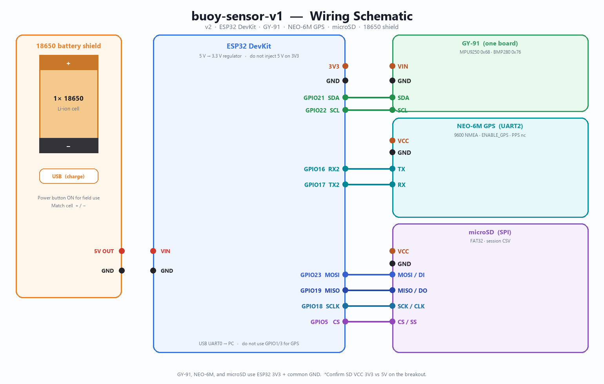
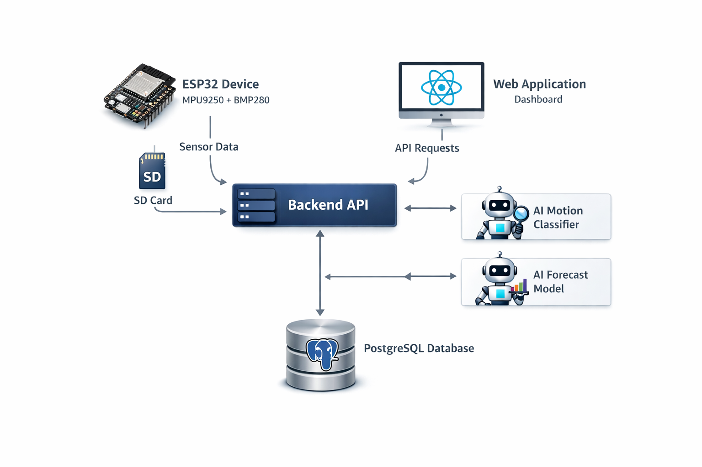

# Proposta de Projeto

**Título do Projeto:** Firmware de boia sensorial para registro de sessões de surfe

**Integrantes:**

- Pedro Silveira

Versão para impressão: [proposta-buoy-sensor.pdf](proposta-buoy-sensor.pdf).

O código é público em [pedro-surf/tcc](https://github.com/pedro-surf/tcc). O texto abaixo descreve o firmware em `../tcc`, pacote [packages/firmware/buoy-sensor-v1](https://github.com/pedro-surf/tcc/tree/main/packages/firmware/buoy-sensor-v1). Esta pasta não copia o código: aponta para o repositório e reúne a documentação, o esquemático e a figura de arquitetura.

## 1. Introdução

### Contextualização

Uma sessão de surfe costuma ser descrita por uma previsão de vento, swell e maré. Essa previsão não registra o que a prancha fez na água: a trajetória, a orientação e o tempo de sessão. O repositório do trabalho trata esse registro como um sistema. Um nó com ESP32 coleta a sessão. Uma API em Node.js grava sessões e amostras em PostgreSQL. Uma aplicação web consulta esses dados, inclusive uma vista ao vivo. Um classificador transforma a série inercial em eventos de movimento, e um módulo de previsão cruza a condição local com a previsão externa.

Esta proposta cobre o firmware desse nó, o pacote `buoy-sensor-v1`. O restante da plataforma entra como destino dos dados.

### Problemática

Na água o telefone não vai na prancha, e a rede da praia não é um caminho estável. O nó precisa amostrar movimento, posição e ambiente, guardar a sessão no cartão e publicar o que a rede alcançar.

O firmware em `../tcc` já faz o bring-up completo dessa coleta. O `app_main` sobe o relógio, o I2C, a IMU e o barômetro no módulo GY-91, a fusão complementar, o GPS NEO-6M na UART2, o microSD e o cliente MQTT. A malha de amostragem é de 10 Hz. Cada amostra pode ir para um CSV de sessão e para o broker. O que ainda não fecha o sistema é a ingestão dessas amostras em linhas de `Session` e `Sample` no backend, e a troca do broker público de bancada por um broker próprio.

### Justificativa

O nó já produz a série que o restante do trabalho consome: aceleração e giro em g e dps, magnetômetro em µT, roll, pitch e yaw, pressão, temperatura e o último fix GGA. O cartão guarda a sessão mesmo se o MQTT cair. O GPS entra a 1 Hz, em tarefa separada, para não atrasar a malha de 10 Hz. Fechar a ingestão no backend liga essa sessão à plataforma que já está no repositório.

### Objetivo geral

Consolidar o firmware do nó sensor para que uma sessão de surfe seja adquirida a 10 Hz, gravada no microSD, publicada por MQTT e ingerida na plataforma publicada em [pedro-surf/tcc](https://github.com/pedro-surf/tcc).

### Objetivos específicos

1. Manter a leitura I2C do GY-91: MPU9250 em 0x68, AK8963 em 0x0C e BMP280 em 0x76.
2. Manter a malha de 10 Hz, com o NEO-6M em tarefa própria na UART2 e o último fix copiado para cada amostra.
3. Gravar a sessão em CSV no microSD, com relógio UTC vindo de SNTP ou do comando serial `TIME`.
4. Publicar amostras em MQTT e ingeri-las no modelo `Sample`.
5. Verificar, ao ar livre, identificadores dos chips, fix de GPS, arquivo de sessão e entrega no broker, pelos critérios da seção 3.4.

## 2. Requisitos do Sistema

### 2.1. Requisitos funcionais

- RF01. Ler aceleração e velocidade angular do MPU9250 no I2C, endereço 0x68.
- RF02. Ler o magnetômetro AK8963 no endereço 0x0C, com `WHO_AM_I` do MPU em 0x71 e `WIA` do AK8963 em 0x48. O interruptor é `ENABLE_MAG`.
- RF03. Ler pressão em pascal e temperatura em graus Celsius do BMP280, endereço 0x76, ID 0x58.
- RF04. Calcular roll e pitch por filtro complementar e yaw por integração do giro, em radianos, sem alterar a IMU crua. O interruptor é `ENABLE_FUSION`.
- RF05. Amostrar a malha a 10 Hz (`SAMPLE_PERIOD_MS` 100).
- RF06. Ler o NEO-6M na UART2, 9600 8N1, GPIO16 como RX e GPIO17 como TX, quando `ENABLE_GPS` está ligado. O módulo fala NMEA; o driver guarda o último `$GPGGA` ou `$GNGGA`.
- RF07. Não analisar NMEA dentro da tarefa de 10 Hz. A tarefa `gps` tem prioridade 4, abaixo da tarefa de sensor.
- RF08. Com `GPS_HOLD_ENABLE`, republicar a posição só quando o salto passa de `max(3 m, HDOP × 3 m)`. Sem fix, a posição anterior permanece e `fix` vai a zero.
- RF09. Gravar CSV em `/sdcard/sessions/`, com flush a cada 20 amostras (cerca de 2 s). Se o cartão falhar, a amostragem segue no UART e no MQTT.
- RF10. Ajustar o relógio por SNTP depois do Wi-Fi, ou pelo console (`TIME 2026-10-09T15:04:00` ou um Unix em segundos). O cabeçalho do CSV guarda `t0_unix_ms`.
- RF11. Publicar JSON no tópico `buoy-sensor-v1/buoy-<mac>/sample` do broker configurado. A taxa é `MQTT_PUBLISH_EVERY_N`.
- RF12. Logar no UART0, a cada 10 amostras, uma linha com IMU, orientação, pressão, GPS, estado do cartão e estado do MQTT.
- RF13. Se um sensor falhar na inicialização, registrar a falha e continuar com os demais.

O CSV de sessão, no esquema versão 4 do firmware, é:

```text
timestamp_ms,ax,ay,az,gx,gy,gz,mx,my,mz,roll,pitch,yaw,pressure_pa,temperature_c,lat,lon,fix,alt,sat
```

Unidades no cabeçalho: g, dps, µT, rad, Pa, °C, graus no fix de GPS e metros. Aceleração permanece em g, que é a escala do driver e a coluna `Sample.ax` documentada no README do firmware.

### 2.2. Requisitos não funcionais

- Desempenho. A malha de 10 Hz não espera o GPS. A UART do módulo é lida em outra tarefa, com timeout de 1,5 s por linha.
- Confiabilidade. Um corte de energia perde no máximo o bloco ainda não sincronizado (até cerca de 2 s com flush a cada 20 amostras). Cartão ausente não derruba a amostragem.
- Energia. A alimentação de campo desenhada é uma célula 18650 e um shield com saída de 5 V no VIN do ESP32. O NEO-6M, em placas com LDO, alimenta-se em 5 V, não no 3V3. A nota de projeto estima cerca de 45 mA no rastreio do GPS. Essa corrente é estimativa, não medição desta proposta.
- Segurança dos dados. O broker de bancada citado no firmware é público (`broker.emqx.io`, porta 1883). Serve ao bring-up. Sessão real muda para um broker próprio. Credenciais de Wi-Fi ficam no componente de rede do firmware, não neste texto.
- Usabilidade. O ciclo de bancada é gravar, abrir o monitor em 115200 e, ao ar livre, ver `fix` sair de 0. Não há tela no nó. O comando `TIME` no console cobre o relógio quando não há NTP.
- Comunicação. I2C nos GPIO21 e GPIO22. SPI do cartão nos GPIO23, GPIO19, GPIO18 e GPIO5. UART2 para o GPS. UART0 reservada ao console e ao flash. Em módulo WROVER com PSRAM, GPIO16 e GPIO17 estão ocupados: o GPS passa para GPIO4 e GPIO15.
- Escopo. O classificador e a previsão consomem a série. Não entram no firmware.

## 3. Proposta de Solução

### 3.1. Arquitetura da Solução

O nó é um ESP32 DevKit em ESP-IDF e FreeRTOS. Os sensores de movimento e de ambiente estão no mesmo módulo GY-91: MPU9250, AK8963 e BMP280 no mesmo I2C. O NEO-6M entra pela UART2. O microSD entra por SPI. A energia de campo é o shield 18650, com 5 V no VIN e no VCC do GPS, e 3,3 V do próprio ESP32 para o GY-91 e para o cartão.

O esquemático de ligações do firmware, com GPS, é o da figura abaixo. A tabela de pinos e a lista de nets estão em [documentacao/esquematico.md](documentacao/esquematico.md). O uso do NEO-6M, incluindo NMEA, checksum e a tarefa em segundo plano, está em [documentacao/gps-neo-6m.md](documentacao/gps-neo-6m.md).



| Barramento | Pinos | Papel |
| --- | --- | --- |
| I2C | SDA GPIO21, SCL GPIO22 | GY-91: MPU9250 0x68, AK8963 0x0C, BMP280 0x76 |
| UART2 | RX GPIO16, TX GPIO17, 9600 8N1 | NEO-6M, TX do módulo no RX do ESP32 |
| SPI | MOSI 23, MISO 19, SCLK 18, CS 5 | microSD, FAT32, CSV de sessão |
| UART0 | console 115200 | flash e monitor; não recebe o GPS |
| 5 V | VIN e VCC do NEO-6M | saída 5 V do shield 18650 |
| 3V3 | GY-91 e microSD | regulador da placa; não injetar 5 V neste pino |

Em volta do firmware, a plataforma recebe a sessão pelo MQTT e pelo CSV. A API persiste em PostgreSQL e serve a aplicação web, o classificador e a previsão.



| Parte | No firmware em `../tcc` | O que a proposta ainda fecha |
| --- | --- | --- |
| I2C, IMU, mag, BMP280 | ligados no `app_main`, 10 Hz | manter e medir no ar livre |
| Fusão complementar | `ENABLE_FUSION` 1 | conferir roll e pitch em repouso |
| NEO-6M | UART2, `ENABLE_GPS` 1, tarefa `gps` | fix ao ar livre e o portão de HDOP |
| microSD | CSV de sessão, flush a cada 20 amostras | arquivo íntegro depois de desligar |
| Relógio | SNTP ou `TIME` no console | `t0_unix_ms` coerente com o UTC |
| MQTT | broker público de bancada | ingerir em `Sample`; broker próprio para sessão real |

A versão sem GPS do mesmo desenho está em [figuras/esquematico-buoy-sensor-v1-sem-gps.png](figuras/esquematico-buoy-sensor-v1-sem-gps.png).

### 3.2. Tecnologias e Ferramentas

- Hardware. ESP32 DevKit, porque o firmware já está em ESP-IDF e o rádio cabe no mesmo chip. GY-91, porque MPU9250 e BMP280 já compartilham SDA e SCL na placa. NEO-6M em UART, 9600 baud, 1 Hz, que basta para a rota. microSD em SPI. Shield 18650 como alimentação de campo ilustrada no esquemático.
- Linguagem. C no firmware (`i2c_bus`, `mpu9250`, `bmp280`, `sensor`, `gps`, `storage`, `wifi`, `clock`, `fusion`). O backend do monorepo é TypeScript. Esta proposta não reescreve a API.
- Plataforma. ESP-IDF e FreeRTOS. Os interruptores de build estão em `main/config.h`: `ENABLE_SD`, `ENABLE_MQTT`, `ENABLE_MAG`, `ENABLE_FUSION` e `ENABLE_GPS`.
- Comunicação. I2C, SPI e NMEA no nó. MQTT no broker de bancada. A aplicação web assina o fluxo ao vivo por SSE a partir do backend. Sem HTTP de amostra no caminho crítico: o desenho publicado é MQTT mais CSV.
- Dados. CSV no cartão, com o esquema da seção 2.1. PostgreSQL, Prisma e o modelo `Sample` na API. Magnetômetro, pressão, temperatura e orientação que não cabem em `Sample` seguem o mapeamento do README do firmware para `Sensor.data`.
- Ferramentas. `idf.py` para build, flash e monitor. Git e o repositório público. `mosquitto_sub` ou o cliente web da EMQX para ver o tópico. Docker para o Postgres local.

A escolha permanece no que esse firmware já compila. Trocar de IMU, de GPS ou de protocolo de entrega abriria outro projeto em cima de um bring-up que já lê os sensores e já publica.

### 3.3. Estratégia de Desenvolvimento

1. Requisitos. O README do firmware, o esquemático e a nota do NEO-6M já fixam pinos, taxas e CSV. Esta proposta os toma como contrato.
2. Tecnologias. ESP32, GY-91, NEO-6M, microSD e MQTT estão escolhidos no código.
3. Arquitetura. O esquemático v2 e a figura de sistema desta pasta são o desenho de referência.
4. Hardware. Montar o shield 18650 no VIN, o GY-91 no I2C em 3,3 V, o cartão no SPI e o NEO-6M com VCC em 5 V e TX/RX cruzados.
5. Firmware. O bring-up descrito acima já está em `../tcc`. O trabalho de código que resta no próprio README é a ingestão no backend e a limpeza dos arquivos de exemplo de Wi-Fi.
6. Integração. Assinar o tópico, ou importar o CSV, e criar `Session` e `Sample`. Manter g e dps como o arquivo já grava.
7. Testes. Executar o plano da seção 3.4 na bancada e ao ar livre.
8. Documentação. As cópias desta pasta acompanham o firmware. Se pinos ou o esquema do CSV mudarem, atualizam-se o README do pacote e estas cópias juntos.

O protótipo funcional é o nó que, ao ar livre, abre um CSV com IMU, barômetro e fix, e publica no broker uma amostra consultável. Caixa estanque e fixação na prancha são condição para entrar na água, não condição para aceitar o firmware.

### 3.4. Plano de Avaliação

A avaliação olha o nó sensor. Não avalia a interface web nem a qualidade do classificador.

| Critério | Método | Resultado esperado |
| --- | --- | --- |
| MPU9250 | WHO_AM_I no monitor, no boot | 0x71; em clone, 0x70 ou 0x73 com aviso |
| AK8963 | WIA depois do bypass I2C | 0x48 |
| BMP280 | registrador de ID | 0x58 |
| Malha | intervalo entre amostras no CSV | cerca de 100 ms |
| GPS | céu aberto, antena para o céu | `NMEA GGA ok`, depois `fix=1` e `sat` de pelo menos 4 |
| GPS parado | módulo parado ao ar livre, hold ligado | a posição não passeia dentro do portão de HDOP |
| Perda de fix | cobrir a antena | `fix` volta a 0 e a amostragem continua |
| Cartão | gravar, desligar, remontar | CSV abre, cabeçalho com `t0_unix_ms` se o relógio foi ajustado |
| Cartão ausente | boot sem o microSD | UART e MQTT seguem |
| MQTT | assinar `buoy-sensor-v1/+/sample` | JSON com IMU e, com GPS ligado, lat, lon, fix, alt, sat |
| Relógio | SNTP ou `TIME` no console | cabeçalho da sessão com origem do tempo |
| Alimentação do GPS | VCC do NEO-6M | 5 V do shield, não o pino 3V3 |

O bring-up está aceito quando o monitor mostra os três identificadores, uma linha de log a cerca de 1 Hz e, ao ar livre, um fix. A sessão está aceita quando o CSV e o broker contam a mesma amostra. A estimativa de 45 mA do NEO-6M em rastreio continua estimativa até haver uma medida na alimentação.

### 3.5. Recursos e Viabilidade

Já disponíveis:

- Firmware em `../tcc` com GPS, cartão, MQTT, magnetômetro e fusão, e o devcontainer do pacote.
- ESP-IDF, FreeRTOS e `idf.py`, sem custo de licença.
- Esquemático, nota do NEO-6M e nota de fusão, copiados nesta pasta.
- API com Prisma, GraphQL e Postgres via Docker, mais a aplicação web.
- Broker público de bancada, sem conta, para o bring-up.
- Repositório [pedro-surf/tcc](https://github.com/pedro-surf/tcc).

Na montagem de campo, como o esquemático já lista:

- ESP32 DevKit, módulo GY-91 e NEO-6M com antena.
- Módulo microSD e cartão FAT32.
- Shield 18650, uma célula e o cabo de 5 V para o VIN.
- Caixa estanque só para o ensaio na água.

Ferramenta de software não entra no custo. A limitação operacional é o mar: o firmware se prova na bancada e ao ar livre. Entrar na água espera caixa e vedação, e não bloqueia os critérios de taxa, arquivo e MQTT.

### 3.6. Riscos e Limitações

- Fix somente ao ar livre. Dentro de casa o NEO-6M pode não fechar. O ensaio de GPS é externo, com a antena para o céu. Cold start pode levar de 30 s a alguns minutos.
- VCC em 3,3 V na placa com LDO. O chip fica abaixo da tensão e não há fix. O esquemático manda 5 V do shield no VCC.
- TX e RX trocados. O sintoma é silêncio na UART2. O módulo TX entra no GPIO16.
- UART0 usada pelo GPS. GPIO1 e GPIO3 são o console. O GPS fica na UART2.
- PSRAM em WROVER. GPIO16 e GPIO17 deixam de estar livres. A nota do módulo manda GPIO4 e GPIO15.
- Broker público. Qualquer um pode assinar o tópico de bancada. Vale para o bring-up. Sessão real usa broker próprio, que é o próximo passo já escrito no README do firmware.
- Cartão e unidade. O CSV está em g, não em m/s². A ingestão não pode reinterpretar a coluna sem combinar com o README do firmware.
- Prazo. A coleta já está no código. O risco restante é a ingestão no backend e o ensaio ao ar livre, não a escolha da plataforma.
- Água. O ensaio de firmware é seco ou à beira d'água. A caixa estanque precede qualquer sessão na arrebentação.

## 4. Considerações Finais

A proposta descreve o nó que o firmware em `../tcc` já é: ESP32, GY-91, NEO-6M, microSD e MQTT, a 10 Hz, com a posição encaixada na amostra sem segurar a malha inercial. O esquemático e a nota de uso do GPS estão copiados nesta pasta e batem com `main/config.h`.

O que falta para o objetivo não é outro driver. É ingerir o CSV ou o tópico em `Sample`, medir o fix ao ar livre e tirar a sessão real do broker público. Com isso a sessão de surfe fica registrada no cartão e consultável na plataforma, que é o resultado que esta proposta se compromete a mostrar.

## Documentos desta pasta

- [documentacao/firmware-buoy-sensor-v1.md](documentacao/firmware-buoy-sensor-v1.md), README do firmware.
- [documentacao/gps-neo-6m.md](documentacao/gps-neo-6m.md), uso do NEO-6M.
- [documentacao/esquematico.md](documentacao/esquematico.md), esquemático de ligações e lista de nets.
- [documentacao/fusao-complementar.md](documentacao/fusao-complementar.md), filtro complementar.
- [documentacao/notas-de-hardware-e-sessao.md](documentacao/notas-de-hardware-e-sessao.md), notas antigas de hardware. Pinos e taxa atuais estão no esquemático.
- [documentacao/classificador-de-movimento.md](documentacao/classificador-de-movimento.md), README do classificador.
- [figuras/esquematico-buoy-sensor-v1.png](figuras/esquematico-buoy-sensor-v1.png)
- [figuras/esquematico-buoy-sensor-v1-sem-gps.png](figuras/esquematico-buoy-sensor-v1-sem-gps.png)
- [figuras/arquitetura-sistema-surfe.png](figuras/arquitetura-sistema-surfe.png)
- [proposta-buoy-sensor.pdf](proposta-buoy-sensor.pdf)

Links públicos:

- [Monorepo](https://github.com/pedro-surf/tcc)
- [Firmware buoy-sensor-v1](https://github.com/pedro-surf/tcc/tree/main/packages/firmware/buoy-sensor-v1)
- [API](https://github.com/pedro-surf/tcc/tree/main/packages/backend)
- [Classificador](https://github.com/pedro-surf/tcc/blob/main/packages/ai-classifier/README.md)
- [Previsão](https://github.com/pedro-surf/tcc/tree/main/packages/ai-forecast)
